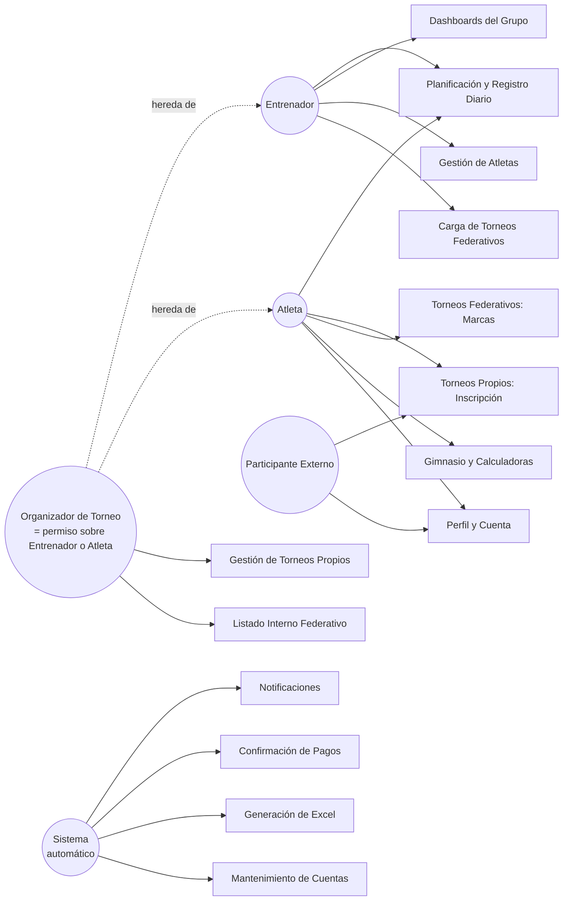

# Diagramas y Especificación de Casos de Uso

## Plataforma Web PWA de Gestión de Entrenamiento para Atletismo

**Versión:** 1.1 · **Estado:** Borrador para revisión (Parte 1: diagrama + índice maestro) · **Documento anterior en la cadena:** `04_Catalogo_Reglas_de_Negocio.md`

---

## 1. Cómo Leer este Documento

Este documento traduce los Requerimientos Funcionales (Paso 2) a **interacciones concretas entre un actor y el sistema**. Mientras un RF dice "el sistema debe permitir X", un Caso de Uso (CU) cuenta la historia completa: quién lo hace, en qué orden, qué pasa si algo sale mal, y cómo se sabe que terminó bien.

Esta primera entrega es el **panorama completo**: el diagrama de actores y un índice maestro con los ~50 casos de uso identificados. La especificación detallada de cada uno (precondición, flujo principal, flujos alternativos, postcondición) se arma en una segunda entrega, una vez que confirmes que no falta ni sobra ningún caso acá.

### 1.1 Actores del sistema

| Actor                     | Resumen                                                                                                                |
| ------------------------- | ---------------------------------------------------------------------------------------------------------------------- |
| **Atleta**                | Usuario que entrena. Elige su Entrenador Principal al registrarse y puede sumar secundarios.                           |
| **Entrenador**            | Usuario validado en padrón. Sincroniza Google Sheets, gestiona permisos de Organizador, configura cuenta institucional |
| **Entrenador Secundario** | Usuario validado en padrón, asociado por el atleta para lectura de dashboards (sin permisos de edición de plan).       |
| **Participante externo**  | Usuario con acceso restringido a Perfil y a la inscripción de torneos propios.                                         |
| **Organizador de Torneo** | Permiso asignado por el Entrenador Principal para gestionar un torneo y subir su PDF cronograma.                       |
| **Sistema**               | Actor no humano: procesos automáticos disparados por tiempo o por eventos externos (Mercado Pago, cron jobs).          |

---

## 2. Diagrama de Actores y Módulos (panorama general)

---

## 3. Índice Maestro de Casos de Uso

### 3.1 Actor: Atleta

| ID    | Nombre                                      | Descripción breve                                                                                | RF relacionados            |
| ----- | ------------------------------------------- | ------------------------------------------------------------------------------------------------ | -------------------------- |
| CU-01 | Registrarse como Atleta                     | Alta de cuenta con datos obligatorios de perfil. Atleta aosciado al Entrenador Principal oficial | RF-58, RF-59, RF-86, RF-90 |
| CU-02 | Iniciar sesión                              | Login con email/contraseña.                                                                      | RF-58                      |
| CU-03 | Recuperar contraseña olvidada               | Solicitar y usar enlace de restablecimiento.                                                     | RF-86, RF-87, RF-88        |
| CU-04 | Ver plan de entrenamiento del día           | Consultar la Portada Principal.                                                                  | RF-11                      |
| CU-05 | Registrar entrenamiento diario              | Marcar Completado o No realizado (con motivo); sensaciones, clima y calzado cuando entrenó.                                           | RF-12 a RF-16              |
| CU-06 | Editar registro retroactivo                 | Completar/corregir un día anterior dentro de la semana en curso.                                 | RF-17                      |
| CU-07 | Consultar vista semanal panorámica          | Ver la grilla completa del plan vigente.                                                         | RF-05, RF-07               |
| CU-08 | Consultar métricas propias                  | Ver asistencias y distribución de sensaciones reales.                                                 | RF-27                      |
| CU-09 | Inscribirse a un torneo propio              | Flujo completo: categoría única, pruebas habilitadas, apto adjunto y pago.                                                    | RF-31 a RF-37, RF-44       |
| CU-10 | Consultar estado de inscripción a torneo    | Ver estados separados de inscripción y pago.                                                      | RF-95 (notificación)       |
| CU-11 | Ver cronograma de un torneo propio          | Consultar horarios de pruebas/categorías.                                                        | RF-30                      |
| CU-12 | Ver cuenta regresiva de torneos federativos | Consultar fechas cargadas manualmente.                                                           | RF-46                      |
| CU-13 | Registrar marca post-competencia            | Cargar manualmente marca/PB, viento y estado especial.                                                             | RF-49                      |
| CU-14 | Consultar historial de marcas y PBs         | Ver ficha deportiva y récords.                                                                   | RF-50, RF-61               |
| CU-15 | Usar calculadora de gimnasio (1RM)          | Calcular peso a levantar según %.                                                                | RF-55                      |
| CU-16 | Usar calculadora de tiempos de pasada       | Calcular tiempo objetivo según calzado.                                                          | RF-56, RF-57               |
| CU-17 | Consultar biblioteca de ejercicios          | Ver ejercicios y generar rutina aleatoria.                                                       | RF-53, RF-54               |
| CU-18 | Editar perfil personal                      | Modificar datos, peso, ficha deportiva, historial médico.                                        | RF-59 a RF-64              |
| CU-19 | Completar checklist de viaje                | Marcar ítems del checklist personalizable.                                                       | RF-64                      |

### 3.2 Actor: Participante Externo

| ID    | Nombre                                           | Descripción breve                                                   | RF relacionados      |
| ----- | ------------------------------------------------ | ------------------------------------------------------------------- | -------------------- |
| CU-20 | Registrarse como Participante externo            | Alta con datos mínimos (nombre, apellido, fecha nac., apto médico). | RF-58, RF-78         |
| CU-21 | Inscribirse a torneo propio (acceso restringido) | Mismo flujo que CU-09, sin ver el resto de la app.                  | RF-31 a RF-37, RF-69 |
| CU-22 | Editar perfil (datos mínimos)                    | Modificar únicamente los campos que le corresponden.                | RF-78, RF-79         |

### 3.3 Actor: Entrenador

| ID    | Nombre                                           | Descripción breve                                             | RF relacionados |
| ----- | ------------------------------------------------ | ------------------------------------------------------------- | --------------- |
| CU-23 | Vincular y sincronizar Google Sheets             | Conectar link, elegir pestaña y parsear planes dinámicamente. | RF-01 a RF-04   |
| CU-24 | Corregir plan de una semana en curso             | Releer Google Sheets respetando registros previos.                    | RF-09           |
| CU-25 | Consultar historial de versiones de un plan      | Ver versiones anteriores de una semana.                       | RF-10           |
| CU-26 | Ver dashboard diario del grupo                   | Asistencia, distribución de RPE, alertas violeta.             | RF-21 a RF-24   |
| CU-27 | Ver dashboard semanal del grupo                  | Carga acumulada y matriz de rendimiento.                      | RF-25, RF-26    |
| CU-28 | Ver listado de atletas a cargo                   | Consultar atletas asignados, agrupados por especialidad.      | RF-66, RF-90    |
| CU-29 | Desactivar cuenta de un Atleta                   | Marcar como "Inactiva" cuando deja el grupo.                  | RF-91, RF-92    |
| CU-30 | Reactivar cuenta de un Atleta                    | Restaurar acceso conservando el historial.                    | RF-93           |
| CU-31 | Asignar/Revocar permiso de Organizador de Torneo | Otorgar o quitar el permiso a un Entrenador o Atleta.         | RF-70, RF-71    |
| CU-32 | Cargar fecha de torneo federativo                | Alimentar la cuenta regresiva (FAM/CADA).                     | RF-45           |
| CU-33 | Configurar cuenta de cobro institucional         | Definir alias/CVU/Mercado Pago usado en todos los torneos.    | DK-09           |
| CU-34 | Editar perfil profesional                        | Modificar licencia federativa y demás datos.                  | RF-65, RF-105   |

### 3.4 Actor: Organizador de Torneo (permiso sobre Entrenador o Atleta)

| ID    | Nombre                                            | Descripción breve                                         | RF relacionados      |
| ----- | ------------------------------------------------- | --------------------------------------------------------- | -------------------- |
| CU-35 | Crear torneo                                      | Cargar datos base: nombre, fechas, categorías, pruebas.   | RF-28                |
| CU-36 | Editar torneo                                     | Modificar datos mientras la inscripción esté abierta.     | RF-97, RF-98         |
| CU-37 | Cargar cronograma del torneo                      | Definir horario por prueba/categoría.                     | RF-29                |
| CU-38 | Revisar y resolver una inscripción                | Aprobar o rechazar según el comprobante.                  | RF-39, RF-81         |
| CU-39 | Ver monto total recaudado                         | Consultar la suma de inscripciones aprobadas.             | RF-41, RF-42         |
| CU-40 | Cancelar o postergar un torneo                    | Marcar y notificar; si se fija una nueva fecha, reprogramar cierre y Excel.    | RF-99, RF-100        |
| CU-41 | Gestionar listado interno de atletas (federativo) | Agregar/quitar atletas interesados en un torneo FAM/CADA. | RF-47, RF-48         |
| CU-42 | Descargar Excel de inscriptos                     | Obtener el archivo ya generado por categoría/prueba.      | RF-43, RF-82 a RF-85 |

### 3.5 Actor: Sistema (procesos automáticos)

| ID    | Nombre                                        | Disparador                                                       | RF relacionados |
| ----- | --------------------------------------------- | ---------------------------------------------------------------- | --------------- |
| CU-43 | Enviar recordatorio diario de entrenamiento   | Todos los días a las 19:00 hs.                                   | RF-72           |
| CU-44 | Marcar día como "Sin registrar"                  | Todos los días a las 23:59 hs.                                   | RF-20           |
| CU-45 | Confirmar pago automáticamente (Mercado Pago) | Notificación de pago aprobado.                                   | RF-38           |
| CU-46 | Generar Excel de inscriptos                   | Solo el día anterior al torneo a las 22:00 hs. | RF-82 a RF-85   |
| CU-47 | Enviar recordatorio de cierre al Organizador  | Días antes de la fecha límite de inscripción.                    | RF-96           |
| CU-48 | Notificar cambio de estado de inscripción     | Cuando una inscripción pasa a Confirmada o Rechazada.            | RF-95           |
| CU-49 | Eliminar cuenta inactiva                      | Al cumplirse 1 año sin reactivación; anonimizar perfil y conservar históricos necesarios.                             | RF-94           |
| CU-50 | Cerrar sesión por inactividad                 | Al cumplirse 2 meses sin uso de la app.                          | RF-73           |

---

## 4. Especificación Detallada — Actor: Atleta

#### CU-01 — Registrarse como Atleta

**Actor:** Atleta.
**Precondición:** No dispone de una cuenta activa.
**Flujo principal:**
1. Selecciona «Atleta» en el registro.
2. Completa nombre, apellido, fecha de nacimiento y email dos veces.
3. Selecciona un Entrenador Principal validado de la lista.
4. Define una contraseña conforme a RF-101.
5. Adjunta obligatoriamente su apto médico e indica fecha de carga.
6. El sistema valida campos y archivo, calcula la categoría por año y crea la cuenta.
7. Puede completar después peso, 1RM, PB, ficha deportiva e historial médico; la foto es opcional.
**Alternativos:** A1 emails distintos → bloqueo; A2 contraseña inválida → bloqueo; A3 sin entrenador o apto → bloqueo; A4 documento inválido por formato/tamaño → aviso y reintento.
**Postcondición:** Cuenta activa asociada al entrenador, con apto adjunto y perfil deportivo progresivo.
**RF relacionados:** RF-58, RF-59, RF-60, RF-90, RF-101, RF-102, RF-104, RF-111.

---

#### CU-02 — Iniciar sesión

**Actor:** Atleta
**Precondición:** Cuenta existente.
**Flujo principal:**

1. El Atleta ingresa email y contraseña.
2. El sistema valida las credenciales.
3. El sistema inicia sesión y redirige a la Portada Principal.

**Flujos alternativos / excepciones:**

- A1: Credenciales incorrectas → el sistema muestra error genérico y permite reintentar.
- A2: La cuenta está en estado "Inactiva" → el sistema informa que la cuenta fue desactivada y sugiere contactar a su Entrenador para reactivarla (ver CU-30).

**Postcondición:** Sesión iniciada; permanece abierta hasta 2 meses consecutivos sin actividad (DK-05).
**RF relacionados:** RF-58, RF-73

---

#### CU-03 — Recuperar contraseña olvidada

**Actor:** Atleta
**Precondición:** El usuario tiene una cuenta registrada con email válido.
**Flujo principal:**

1. El usuario selecciona "Olvidé mi contraseña" e ingresa su email.
2. El sistema envía un enlace de restablecimiento de un solo uso, con vencimiento a la hora de generado (RN-35).
3. El usuario abre el enlace y define una nueva contraseña (cumpliendo la política de RF-101).
4. El sistema invalida el enlace y confirma el cambio.

**Flujos alternativos / excepciones:**

- A1: El email no corresponde a ninguna cuenta → por seguridad, el sistema muestra el mismo mensaje genérico que si el envío fuera exitoso (no revela si la cuenta existe).
- A2: El enlace ya fue usado o venció → el sistema lo rechaza y ofrece solicitar uno nuevo.

**Postcondición:** Contraseña actualizada; enlace anterior invalidado.
**RF relacionados:** RF-86, RF-87, RF-88

---

#### CU-04 — Ver plan de entrenamiento del día

**Actor:** Atleta
**Precondición:** Sesión iniciada.
**Flujo principal:**

1. El Atleta ingresa a la Portada Principal.
2. El sistema detecta la fecha actual y muestra el bloque correspondiente del plan vigente, en tarjetas.
3. Si el Atleta tiene una especialidad marcada en su perfil, el sistema resalta el bloque de "Trabajo Específico".

**Flujos alternativos / excepciones:**

- A1: No hay un plan cargado para la semana actual → el sistema muestra un estado vacío indicando que el Entrenador todavía no subió la planificación.

**Postcondición:** Ninguna (es una consulta).
**RF relacionados:** RF-06, RF-08, RF-11

---

#### CU-05 — Registrar entrenamiento diario

**Actor:** Atleta.
**Precondición:** Día de la semana actual, lunes a viernes; plan consultable o entrenamiento por cuenta propia.
**Flujo principal:**
1. Elige «Completado» o «No realizado».
2. Si elige Completado, selecciona obligatoriamente sensación (verde Muy suave, amarillo Suave, naranja Medio, rojo Fuerte, violeta Molestia/dolor/lesión) y calzado.
3. Completa opcionalmente clima y observaciones, incluyendo rutina propia si corresponde.
4. Si elige No realizado, selecciona opcionalmente el motivo (descanso indicado, lluvia/suspensión, lesión, enfermedad, personal u otro) y observaciones; no se exigen sensación ni calzado.
5. Guarda la fecha del entrenamiento y momento de registro.
**Alternativos:** A1 faltan sensación/calzado con Completado → no guarda; A2 violeta → alerta al entrenador; A3 sin plan pero realizó gimnasio por su cuenta → puede marcar Completado y describirlo.
**Postcondición:** Completado suma asistencia; No realizado cuenta falta informada.
**RF relacionados:** RF-12 a RF-16, RF-19, RF-23, RF-106, RF-107.

---

#### CU-06 — Editar registro retroactivo

**Actor:** Atleta
**Precondición:** El día a editar pertenece a la semana calendario en curso (hasta el domingo 23:59 hs).
**Flujo principal:**

1. El Atleta accede a la Vista Semanal.
2. Selecciona un día anterior sin completar o a corregir.
3. Edita los campos correspondientes y guarda.

**Flujos alternativos / excepciones:**

- A1: El día pertenece a una semana ya cerrada (a partir del lunes siguiente) → el sistema bloquea la edición (RN-05).

**Postcondición:** Registro actualizado, conservando su fecha original de entrenamiento.
**RF relacionados:** RF-17, RF-18

---

#### CU-07 — Consultar vista semanal panorámica

**Actor:** Atleta
**Precondición:** Existe un plan cargado para la semana consultada.
**Flujo principal:**

1. El Atleta accede a la sección semanal.
2. El sistema renderiza la grilla completa, replicando la estética del Excel original, con desplazamiento horizontal fluido en mobile.

**Postcondición:** Ninguna (consulta).
**RF relacionados:** RF-05, RF-07

---

#### CU-08 — Consultar métricas propias

**Actor:** Atleta.
**Flujo principal:** Consulta asistencias Completadas sobre cinco días esperados (lunes-viernes), faltas informadas/no registradas y distribución de las sensaciones realmente cargadas. Los colores de la planificación no se incluyen.
**Postcondición:** Ninguna (consulta).
**RF relacionados:** RF-27, RF-106, RF-116.

---

#### CU-09 — Inscribirse a un torneo propio

**Actor:** Atleta o Participante externo autenticado.
**Precondición:** Cuenta creada con apto adjunto; torneo abierto; sin inscripción duplicada.
**Flujo principal:**
1. Selecciona torneo.
2. Elige una categoría elegible (propia o superior habilitada), única para todas las pruebas.
3. Selecciona cualquier cantidad de pruebas habilitadas; se permiten horarios superpuestos.
4. Elige Mercado Pago para transacción nueva o transferencia bancaria.
5. Mercado Pago: se redirige al checkout; solo la confirmación autenticada acredita el pago y confirma la inscripción.
6. Transferencia: adjunta comprobante y queda Pendiente hasta aprobación manual.
7. Consulta por separado estado de inscripción y pago.
**Alternativos:** A1 falta apto desde el registro → no puede existir cuenta válida; la renovación anual posterior corresponde al usuario. A2 ya inscripto o fuera de fecha → bloquear. A3 reutiliza crédito acordado de torneo anterior → elige transferencia, adjunta comprobante original y Organizador revisa saldo/origen manualmente. A4 no completa el pago → inscripción Pendiente, no Confirmada.
**Postcondición:** Inscripción con categoría fija, pruebas y estados independientes.
**RF relacionados:** RF-31 a RF-40, RF-44, RF-108, RF-109, RF-113.

---

#### CU-10 — Consultar estado de inscripción a torneo

**Actor:** Atleta o Participante externo.
**Flujo principal:** Consulta estado de inscripción (Pendiente, Confirmada, Rechazada, Cancelada) y estado de pago (Pendiente de verificación, Acreditado, Rechazado, Reintegrado, Aplicado como crédito).
**Postcondición:** Ninguna.
**RF relacionados:** RF-95, RF-113.

---

#### CU-11 — Ver cronograma de un torneo propio

**Actor:** Atleta o Participante externo inscripto.
**Precondición:** PDF oficial adjunto al torneo.
**Flujo principal:** Abre o descarga el PDF oficial que incluye los horarios y pruebas; la aplicación no interpreta ni almacena un cronograma de horarios por prueba.
**Postcondición:** Ninguna (consulta).
**RF relacionados:** RF-29, RF-30.

---

#### CU-12 — Ver cuenta regresiva de torneos federativos

**Actor:** Atleta
**Flujo principal:** El Atleta consulta la sección de torneos federativos y ve los días restantes para cada evento cargado manualmente por el Entrenador/Organizador.
**Postcondición:** Ninguna (consulta).
**RF relacionados:** RF-46

---

#### CU-13 — Registrar marca post-competencia

**Actor:** Atleta.
**Precondición:** Cuenta activa.
**Flujo principal:**
1. Elige prueba y, si corresponde, torneo asociado.
2. Ingresa manualmente el resultado, tiempo o distancia con unidad y precisión, fecha, viento cuando aplica y sensación opcional. Puede registrar DNS, DNF, DQ o NM.
3. Identifica manualmente si se trata de PB/SB en su ficha.
4. El sistema almacena como marca autodeclarada, sin importar resultados ni homologar PB/podio automáticamente.
**Alternativos:** Resultado especial sin marca numérica → se guarda el estado. Dato incoherente → solicitar corrección.
**Postcondición:** Marca o estado competitivo guardado en el historial personal.
**RF relacionados:** RF-49, RF-50, RF-61, RF-115.

---

#### CU-14 — Consultar historial de marcas y PBs

**Actor:** Atleta.
**Flujo principal:** Consulta su ficha deportiva y edita sus PB/SB ingresados manualmente, con prueba, fecha, unidad y viento cuando corresponda. La interfaz los identifica como autodeclarados, no oficiales.
**Postcondición:** Ninguna (consulta) o modificación de ficha.
**RF relacionados:** RF-50, RF-61, RF-115.

---

#### CU-15 — Usar calculadora de gimnasio (1RM)

**Actor:** Atleta
**Flujo principal:**

1. El Atleta selecciona un ejercicio y un porcentaje.
2. El sistema calcula el peso a levantar, aplicando el porcentaje sobre el 1RM guardado en su perfil.

**Postcondición:** Ninguna (cálculo de consulta).
**RF relacionados:** RF-55, RF-63

---

#### CU-16 — Usar calculadora de tiempos de pasada

**Actor:** Atleta
**Flujo principal:**

1. El Atleta selecciona una distancia y un porcentaje de su marca personal.
2. El sistema aplica el coeficiente correspondiente según el calzado seleccionado (zapatillas o clavos) y calcula el tiempo objetivo.

**Postcondición:** Ninguna (cálculo de consulta).
**RF relacionados:** RF-56, RF-57

---

#### CU-17 — Consultar biblioteca de ejercicios

**Actor:** Atleta
**Flujo principal:** El Atleta navega la biblioteca por categoría, o solicita la generación aleatoria de una rutina de N ejercicios.
**Postcondición:** Ninguna (consulta).
**RF relacionados:** RF-53, RF-54

---

#### CU-18 — Editar perfil personal

**Actor:** Atleta
**Flujo principal:** El Atleta modifica sus datos de perfil (todos obligatorios salvo la foto).
**Flujos alternativos / excepciones:**

- A1: Intenta dejar vacío un campo obligatorio → el sistema bloquea el guardado (RN-33).

**Postcondición:** Perfil actualizado.
**RF relacionados:** RF-59 a RF-64

---

#### CU-19 — Completar checklist de viaje

**Actor:** Atleta
**Flujo principal:** El Atleta marca o desmarca ítems de su checklist de viaje personalizable.
**Postcondición:** Checklist actualizado.
**RF relacionados:** RF-64

---

## 5. Especificación Detallada — Actor: Participante Externo

#### CU-20 — Registrarse como Participante externo

**Actor:** Participante Externo.
**Precondición:** No tiene cuenta.
**Flujo principal:**
1. Selecciona «Participante externo».
2. Ingresa nombre, apellido, fecha de nacimiento y email dos veces.
3. Define contraseña válida.
4. Adjunta apto médico obligatorio antes de enviar.
5. El sistema crea la cuenta con acceso a Perfil y torneos propios únicamente.
**Alternativos:** Email o contraseña inválidos, apto ausente o archivo inválido → bloqueo y posibilidad de corregir.
**Postcondición:** Cuenta creada con apto médico adjunto.
**RF relacionados:** RF-58, RF-60, RF-78, RF-101, RF-102.

---

#### CU-21 — Inscribirse a un torneo propio (acceso restringido)

**Actor:** Participante Externo.
**Precondición:** Cuenta registrada con apto adjunto; torneo abierto.
**Flujo principal:** Sigue CU-09: categoría única por torneo, pruebas habilitadas, pago Mercado Pago o transferencia, con estados separados. Solo accede a Perfil e inscripciones de torneos propios, sin dashboards ni torneos federativos.
**Alternativos:** Los del CU-09.
**Postcondición:** Inscripción registrada.
**RF relacionados:** RF-31 a RF-40, RF-44, RF-69, RF-113.

---

#### CU-22 — Editar perfil (datos mínimos)

**Actor:** Participante Externo
**Flujo principal:** El usuario edita nombre, apellido, fecha de nacimiento o apto médico. No ve ni puede editar los campos propios del Atleta (peso, ficha deportiva, historial médico, 1RM), ya que no forman parte de su perfil.
**Postcondición:** Perfil actualizado.
**RF relacionados:** RF-78, RF-79

---

## 6. Especificación Detallada — Actor: Entrenador

#### CU-23 — Vincular y sincronizar planificación desde Google Sheets

**Actor:** Entrenador Principal.
**Precondición:** Google Sheets vinculada y configurada como «Cualquier persona con el enlace: Lector»; si no lo está, el Entrenador debe habilitar el acceso de lectura mediante enlace antes de sincronizar.
**Flujo principal:**
1. Vincula la URL de Google Sheets una vez desde su perfil.
2. Presiona «Sincronizar Planilla» cuando quiere publicar o refrescar.
3. Selecciona la pestaña de la hoja.
4. El sistema vuelve a leer esa pestaña, detecta la palabra «semana», fechas, colores orientativos, especialidades y notas.
5. Valida la estructura y actualiza los planes del grupo por fecha sin exigir subir XLSX.
6. Informa éxito y semanas sincronizadas.
**Alternativos:** A1 enlace inválido o permiso «Cualquier persona con el enlace: Lector» no habilitado → indicar cómo corregirlo y conservar el plan anterior; A2 estructura ilegible o fecha no reconocida → informar error y conservar plan publicado; A3 semana cerrada → ignorar cambios para esa semana.
**Postcondición:** Vista del plan actualizada para los atletas del grupo, sin modificar sus registros.
**RF relacionados:** RF-01 a RF-09, RF-89, RF-112, RF-118.

---

#### CU-24 — Corregir plan de una semana en curso

**Actor:** Entrenador Principal.
**Precondición:** Ya existe plan de semana actual y hoja Google Sheets accesible.
**Flujo principal:**
1. El Entrenador modifica la planificación en la misma Google Sheets.
2. Presiona «Sincronizar Planilla» y selecciona la pestaña correspondiente.
3. El sistema relee la semana y actualiza solo el contenido planificado del día.
4. Conserva sin cambio los estados, sensaciones, calzado, clima y observaciones previamente registrados por atletas, aunque el texto planificado cambie.
**Alternativos:** A1 semana futura → actualización sin registros previos; A2 semana cerrada → se rechaza actualización de esa semana; A3 error de lectura → se conserva plan anterior y se informa.
**Postcondición:** Plan actualizado; registros existentes intactos.
**RF relacionados:** RF-09, RF-10, RF-89, RF-112.

---

#### CU-25 — Consultar historial de versiones de un plan

**Actor:** Entrenador
**Flujo principal:** El Entrenador consulta qué versiones de plan estuvieron vigentes para una semana determinada.
**Postcondición:** Ninguna (consulta).
**RF relacionados:** RF-10

---

#### CU-26 — Ver dashboard diario del grupo

**Actor:** Entrenador
**Flujo principal:** El Entrenador consulta el porcentaje de asistencia del día, el gráfico circular de distribución de sensaciones, las alertas de atletas en zona Violeta, y el desglose individual de cada atleta.
**Postcondición:** Ninguna (consulta).
**RF relacionados:** RF-21 a RF-24

---

#### CU-27 — Ver dashboard semanal del grupo

**Actor:** Entrenador
**Flujo principal:** El Entrenador consulta la asistencia acumulada, el índice de carga (RPE) semanal, y la matriz de rendimiento de todos sus atletas.
**Postcondición:** Ninguna (consulta).
**RF relacionados:** RF-25, RF-26

---

#### CU-28 — Ver listado de atletas a cargo

**Actor:** Entrenador
**Flujo principal:** El Entrenador consulta el listado de atletas asignados a él, agrupados por especialidad.
**Postcondición:** Ninguna (consulta).
**RF relacionados:** RF-66, RF-90

---

#### CU-29 — Desactivar cuenta de un Atleta

**Actor:** Entrenador
**Precondición:** El Atleta pertenece a su grupo y deja de entrenar.
**Flujo principal:**

1. El Entrenador accede al perfil del Atleta.
2. Selecciona "Marcar como Inactivo".
3. El sistema cambia el estado a "Inactiva" y comienza a contar el plazo de 1 año.
4. El sistema oculta al Atleta de los listados y dashboards activos, conservando su historial completo.

**Postcondición:** Cuenta inactiva, oculta de las vistas activas, historial conservado.
**RF relacionados:** RF-91, RF-92

---

#### CU-30 — Reactivar cuenta de un Atleta

**Actor:** Entrenador
**Precondición:** La cuenta del Atleta está en estado "Inactiva" y no transcurrió 1 año desde la desactivación.
**Flujo principal:**

1. El Entrenador busca al Atleta (la búsqueda incluye cuentas inactivas).
2. Selecciona "Reactivar".
3. El sistema restaura el acceso y vuelve a mostrarlo en los listados activos, con su historial intacto.

**Flujos alternativos / excepciones:**

- A1: Ya transcurrió 1 año desde la desactivación → la cuenta ya fue eliminada de forma permanente (ver CU-49) y no puede reactivarse.

**Postcondición:** Cuenta activa nuevamente.
**RF relacionados:** RF-93

---

#### CU-31 — Asignar/Revocar permiso de Organizador de Torneo

**Actor:** Entrenador
**Flujo principal:**

1. El Entrenador Principal visualiza su grupo asignado (Atletas y Secundarios).
2. Otorga o revoca el permiso administrativo de Organizador sobre un torneo específico a uno de los miembros.
3. El miembro adquiere el menú de Gestión de Torneos Propios.

**Postcondición:** Permiso actualizado; si se otorga, la cuenta gana acceso a las funciones de gestión de torneos propios.
**RF relacionados:** RF-70, RF-71

---

#### CU-32 — Cargar fecha de torneo federativo

**Actor:** Entrenador
**Flujo principal:**

1. El Entrenador ingresa a la sección de torneos federativos.
2. Carga manualmente el nombre y la fecha de un torneo de FAM, CADA u otra federación.
3. El sistema genera la cuenta regresiva, visible para Atletas y Entrenadores.

**Postcondición:** Cuenta regresiva creada.
**RF relacionados:** RF-45

---

#### CU-33 — Configurar cuenta de cobro institucional

**Actor:** Entrenador (con permiso de Administrador)
**Flujo principal:**

1. Accede a la configuración del sistema.
2. Define el alias/CBU/CVU o cuenta de Mercado Pago de la cuenta de cobro institucional.

**Postcondición:** Todos los torneos usan esta cuenta configurada para mostrar el medio de pago por transferencia.
**RF relacionados:** RF-105

---

#### CU-34 — Editar perfil profesional

**Actor:** Entrenador
**Flujo principal:** El Entrenador edita nombre, foto (opcional), licencia federativa y su vencimiento.
**Postcondición:** Perfil actualizado.
**RF relacionados:** RF-65

---

## 7. Especificación Detallada — Actor: Organizador de Torneo

#### CU-35 — Crear torneo

**Actor:** Organizador autorizado del torneo.
**Precondición:** Permiso de organización sobre el club/torneo.
**Flujo principal:**
1. Ingresa a «Crear torneo».
2. Indica nombre, sábado/domingo, categorías permitidas y disciplinas habilitadas por categoría.
3. Si es «Provincial en pista propia» aplica cierre martes 12:00; de otro modo miércoles 23:59.
4. Se publica con una única cuenta de cobro del club, sin posibilidad de cambiarla desde el torneo.
**Alternativos:** Datos obligatorios incompletos → bloqueo.
**Postcondición:** Torneo creado.
**RF relacionados:** RF-28, RF-36, RF-40.

---

#### CU-36 — Editar torneo

**Actor:** Organizador del torneo.
**Precondición:** Torneo creado con inscripción abierta.
**Flujo principal:** Edita fechas, categorías, pruebas habilitadas o reemplaza el PDF oficial; guarda cambios.
**Alternativos:** A1 inscripción cerrada → solo Cancelar/Postergar; A2 retira prueba con inscriptos → el sistema notifica a todos los afectados e incluye «Si hiciste el pago en conjunto con otra prueba, por favor comunicate con los organizadores». No procesa devoluciones.
**Postcondición:** Torneo actualizado y bajas notificadas si corresponde.
**RF relacionados:** RF-97, RF-98, RF-110.

---

#### CU-37 — Cargar cronograma del torneo

**Actor:** Organizador de Torneo
**Flujo principal:**

1. El Organizador accede al panel del torneo.
2. Selecciona y adjunta el documento PDF oficial con el detalle de horarios y pruebas.
3. El sistema almacena el PDF y habilita el botón de visualización/descarga para los atletas inscriptos.

**Postcondición:** Cronograma disponible para los inscriptos.
**RF relacionados:** RF-29, RF-30

---

#### CU-38 — Revisar y resolver una inscripción

**Actor:** Organizador del torneo.
**Precondición:** Inscripción Pendiente por transferencia o crédito reutilizado.
**Flujo principal:**
1. Revisa comprobante y datos del torneo.
2. Si es pago anterior usado como crédito, verifica origen, saldo y acuerdo de reutilización.
3. Aprueba manualmente: inscripción Confirmada y pago Acreditado (transferencia nueva) o Aplicado como crédito (saldo anterior).
4. El sistema notifica al participante y registra auditoría.
**Alternativos:** Comprobante inválido → pago Rechazado e inscripción Rechazada; el participante puede reenviar y volver a Pendiente. Crédito ya agotado → impedir aplicación.
**Postcondición:** Estados de pago e inscripción persistidos de forma independiente.
**RF relacionados:** RF-39, RF-81, RF-95, RF-108, RF-109, RF-113.

---

#### CU-39 — Ver monto total recaudado

**Actor:** Organizador autorizado del torneo.
**Flujo principal:** Consulta importes de pagos nuevos Acreditados del torneo y, en una cifra separada, créditos de pagos previos aplicados. Los créditos no se vuelven a sumar como dinero nuevo.
**Postcondición:** Ninguna (consulta).
**RF relacionados:** RF-41, RF-42.

---

#### CU-40 — Cancelar o postergar un torneo

**Actor:** Organizador del torneo.
**Flujo principal:**
1. Marca torneo Cancelado o Postergado. Si posterga, indica nueva fecha cuando la conozca.
2. Se notifica a todos los inscriptos.
3. Si la nueva fecha se establece antes de generar el Excel, el sistema recalcula el cierre de inscripciones y reprograma la exportación a las 22:00 del día anterior a la nueva fecha, dejando sin efecto la tarea anterior.
4. El Organizador coordina fuera de la plataforma cualquier reintegro/crédito y puede después registrar administrativamente su resultado en CU-51.
**Alternativos:** A1 se posterga sin nueva fecha → el torneo queda postergado y no se ejecutan tareas de cierre/exportación hasta fijarla. A2 el Excel ya fue generado → se conserva y se advierte al Organizador que una exportación adicional requiere una decisión expresa.
**Postcondición:** Torneo con nuevo estado; sin movimiento monetario realizado por la plataforma.
**RF relacionados:** RF-99, RF-100, RF-108, RF-117, RF-119.

---

#### CU-41 — Gestionar listado interno de atletas (torneo federativo)

**Actor:** Organizador de Torneo
**Precondición:** Existe un torneo federativo cargado con cuenta regresiva.
**Flujo principal:**

1. El Organizador hace clic en la cuenta regresiva de un torneo federativo.
2. Agrega o quita atletas del listado interno, con sus datos, pruebas y categorías.

**Postcondición:** Listado interno actualizado; no constituye inscripción oficial ante la federación.
**RF relacionados:** RF-47, RF-48

---

#### CU-42 — Descargar Excel de inscriptos

**Actor:** Organizador del torneo.
**Precondición:** Se alcanzó el día anterior al torneo a las 22:00 y se generó la exportación.
**Flujo principal:** Descarga el único Excel generado, con hojas por categoría, bloques por prueba y una sección aparte de solicitudes pendientes.
**Alternativos:** A1 se aprobaron pendientes después de la exportación → el Organizador los agrega manualmente a su copia; la plataforma no regenera el archivo.
**Postcondición:** Excel descargado.
**RF relacionados:** RF-43, RF-82 a RF-85, RF-117, RF-119.

---

## 8. Especificación Detallada — Actor: Sistema

#### CU-43 — Enviar recordatorio diario de entrenamiento

**Actor:** Sistema
**Disparador:** Todos los días a las 19:00 hs.
**Flujo principal:**

1. El sistema identifica a los atletas que no registraron su entrenamiento del día.
2. Les envía una notificación push recordatoria.

**Postcondición:** Notificaciones enviadas.
**RF relacionados:** RF-72

---

#### CU-44 — Marcar día como «Sin registrar»

**Actor externo / disparador:** Proceso temporizado del servidor a las 23:59 de lunes a viernes.
**Flujo principal:** Asigna Sin registrar al día que no tenga registro. Cuenta como falta, al igual que No realizado, pero conserva la distinción para el dashboard.
**Postcondición:** Estado diario actualizado.
**RF relacionados:** RF-20, RF-116.

---

#### CU-45 — Confirmar pago automáticamente (Mercado Pago)

**Disparador:** Notificación recibida de Mercado Pago por transacción nueva.
**Flujo principal:**
1. El servidor valida autenticidad, ID de pago, referencia de inscripción, cuenta destinataria e importe.
2. Verifica el pago con la integración oficial y evita procesar eventos repetidos.
3. Si está Acreditado, cambia pago a Acreditado e inscripción a Confirmada.
4. Envía notificación al participante.
**Alternativos:** Pago no acreditado, monto incongruente o aviso inválido → no confirmar y registrar incidencia.
**Postcondición:** Confirmación consistente y sin cobro duplicado.
**RF relacionados:** RF-38, RF-95, RF-113.

---

#### CU-46 — Generar Excel de inscriptos

**Disparador:** Día anterior a la fecha vigente del torneo a las 22:00, hora argentina; la programación se sustituye si hay postergación antes de ejecutarse.
**Flujo principal:**
1. El sistema consulta las inscripciones Confirmadas y las Pendientes en ese instante.
2. Genera un único Excel por torneo: hojas por categoría y bloques por prueba para confirmados.
3. Agrega una hoja o sección «Inscripciones Pendientes de Aprobación», con sus pruebas y categoría, aunque sea vacía.
4. Habilita descarga al Organizador y guarda fecha y referencia de exportación.
**Alternativos:** A1 si una inscripción se confirma después, se incorpora manualmente a la copia exportada; no se regenera desde el sistema. A2 si el torneo fue postergado antes de generar el Excel, se cancela la ejecución anterior y se usa la nueva víspera. A3 si ya existía una exportación previa a la postergación, se conserva y no se genera otra automáticamente.
**Postcondición:** Único Excel de torneo disponible.
**RF relacionados:** RF-43, RF-82 a RF-85, RF-117, RF-119.

---

#### CU-47 — Enviar recordatorio de cierre al Organizador

**Actor:** Sistema
**Disparador:** Días antes de la fecha límite de inscripción de un torneo (plazo exacto a definir con el equipo técnico).
**Flujo principal:** El sistema notifica al Organizador cuántas solicitudes siguen pendientes de revisión.
**Postcondición:** Notificación enviada.
**RF relacionados:** RF-96

---

#### CU-48 — Notificar cambio de estado de inscripción

**Actor:** Sistema
**Disparador:** Una inscripción cambia a "Confirmada" o "Rechazada".
**Flujo principal:** El sistema envía una notificación al Atleta correspondiente.
**Postcondición:** Atleta notificado.
**RF relacionados:** RF-95

---

#### CU-49 — Eliminar o anonimizar cuenta inactiva

**Disparador:** Un año consecutivo tras la desactivación sin reactivación.
**Flujo principal:**
1. El sistema aplica la política de retención vigente.
2. Elimina o anonimiza datos personales del perfil que ya no correspondan conservar.
3. Preserva registros históricos administrativos o deportivos estrictamente necesarios sin mantener accesible la cuenta personal.
**Postcondición:** Cuenta personal desactivada definitivamente; históricos necesarios preservados.
**RF relacionados:** RF-94.

---

#### CU-50 — Cerrar sesión por inactividad

**Actor:** Sistema
**Disparador:** Se cumplen 2 meses consecutivos sin actividad de un usuario en la aplicación.
**Flujo principal:** El sistema invalida el token de sesión del usuario.
**Postcondición:** Usuario deslogueado; debe volver a iniciar sesión.
**RF relacionados:** RF-73

---

## 9. Casos de uso complementarios aprobados (06/11/2026)

#### CU-51 — Registrar reintegro o crédito administrativo

**Actor:** Organizador autorizado del torneo.
**Precondición:** Inscripción/pago previamente registrado; resolución de devolución o crédito acordada fuera de la plataforma.
**Flujo principal:**
1. Abre el pago original y selecciona «Registrar reintegro» o «Dejar crédito disponible».
2. Indica importe, fecha, motivo y referencia del torneo original.
3. El sistema registra estado «Reintegrado» o saldo disponible como crédito, con auditoría; no transfiere dinero.
4. Si el participante usa el crédito en otro torneo, elige transferencia bancaria y adjunta comprobante original; Organizador revisa y aplica el crédito en CU-38.
**Alternativos:** Crédito insuficiente, ya aplicado o importe superior al disponible → bloquear registro y explicar motivo.
**Postcondición:** Historial administrativo actualizado; pago no contado dos veces.
**RF relacionados:** RF-108, RF-109, RF-113, RNF-21.

#### CU-52 — Registrar falta y motivo

**Actor:** Atleta.
**Precondición:** Día de lunes a viernes dentro de semana editable.
**Flujo principal:**
1. Selecciona «No realizado».
2. Indica, si quiere, el motivo (descanso indicado, suspensión por lluvia, lesión, enfermedad, personal u otro).
3. Agrega observaciones opcionales y guarda.
**Alternativos:** Si no interactúa hasta las 23:59, CU-44 asigna Sin registrar.
**Postcondición:** Falta registrada con motivo opcional; misma incidencia en el porcentaje que Sin registrar.
**RF relacionados:** RF-12, RF-20, RF-106, RF-116.

### Matriz de permisos (resumen)

| Acción | Entrenador Principal | Entrenador Secundario | Organizador del torneo | Atleta | Externo |
| --- | --- | --- | --- | --- | --- |
| Sincronizar planes | Sí | No | No por este permiso | No | No |
| Consultar dashboards de atletas asociados | Sí | Sí | No por este permiso | Solo propios | No |
| Consultar datos médicos de atletas asociados | Sí | Sí | Solo comprobación administrativa de apto para su torneo | Solo propios | Solo propios |
| Crear o administrar torneo | Si tiene permiso de Organizador | Si tiene permiso de Organizador | Sí, solo asignados | Si tiene permiso de Organizador | No |
| Registrar reintegros/créditos administrativos | Si tiene permiso de Organizador | Si tiene permiso de Organizador | Sí, solo asignados | Si tiene permiso de Organizador | No |
| Configurar cuenta de cobro única del club | Sí, responsable habilitado | No | No por este permiso | No | No |

**Regla:** Los permisos se acumulan por roles realmente asignados; recibir permiso de Organizador no habilita automáticamente dashboards ni acceso a historial médico del grupo.
