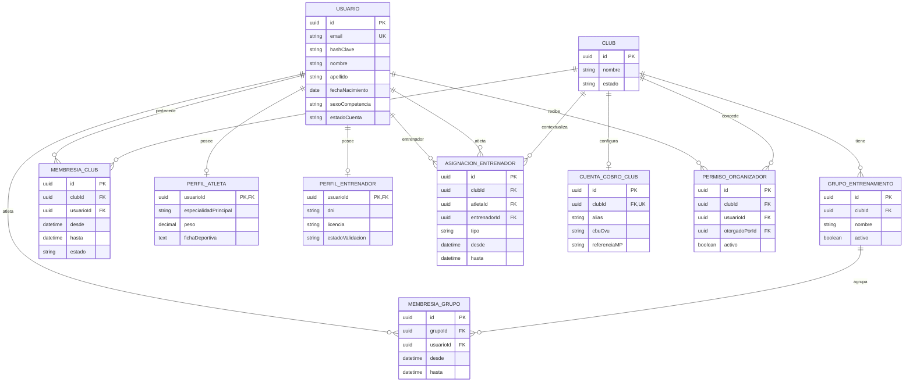
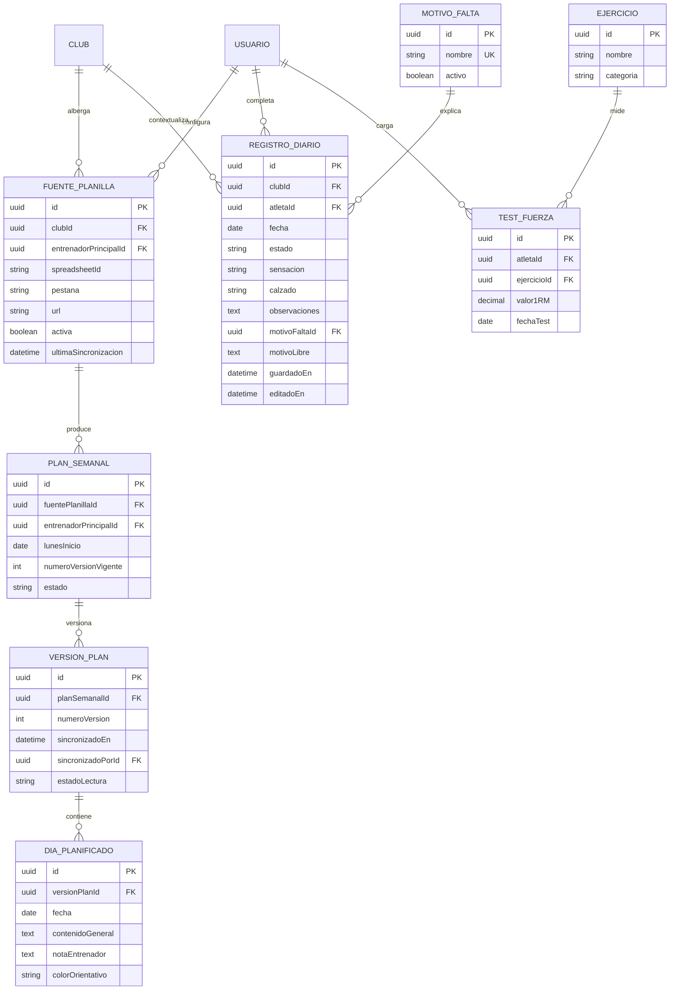
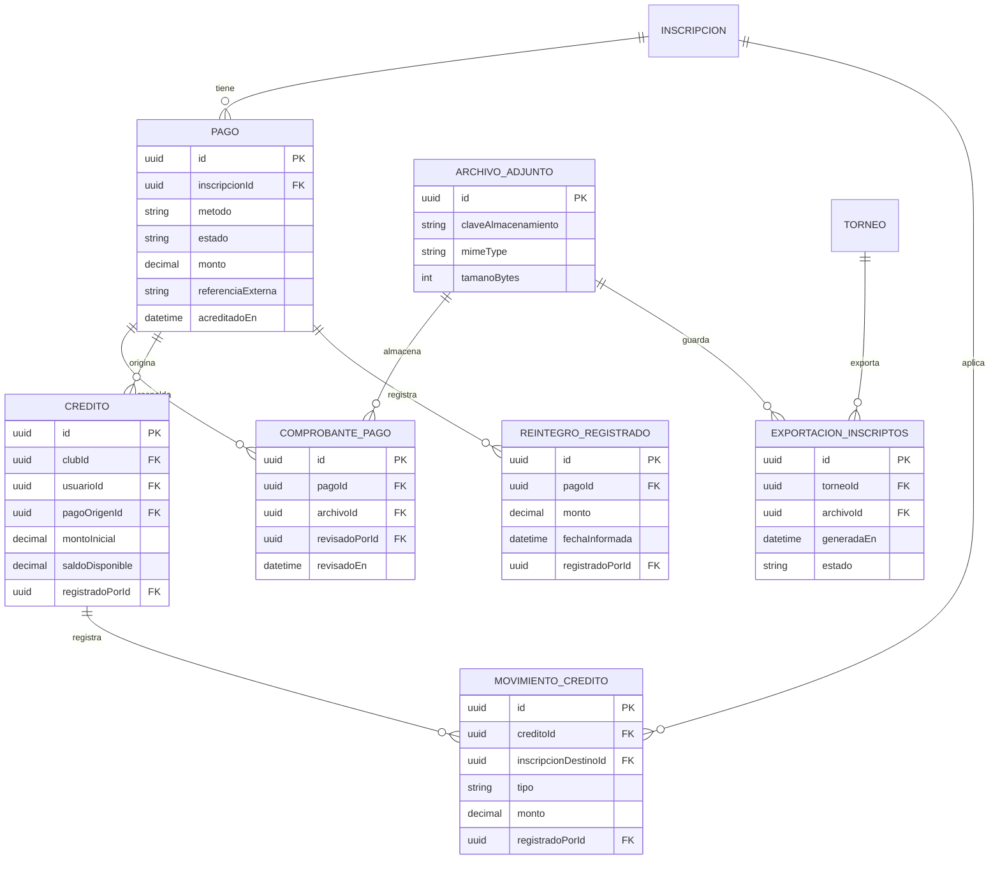
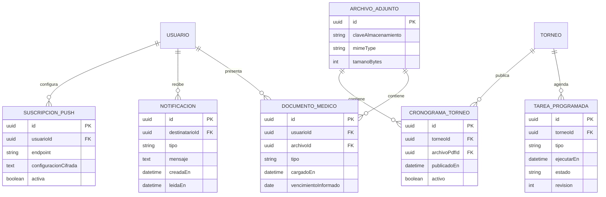

# DER lógico modular — propuesta v0.8

**Proyecto:** PWA de gestión de entrenamiento para atletismo  
**Estado:** propuesta de revisión previa a `schema.prisma`, no esquema ejecutado.  
**Base:** DER v0.7, modelo conceptual v0.3, documentación funcional v2 y decisiones confirmadas para la inscripción y el armado de series. **Nota:** los cinco documentos funcionales no se modifican en esta entrega; las incorporaciones a RF/RN/CU están propuestas al final.  
**Convenciones:** PK = clave primaria; FK = clave foránea; UQ = unicidad; `?` = nulo permitido; `1:N` = uno a muchos. Los nombres de columnas son una **propuesta técnica** y pueden cambiar al generar Prisma. Los atributos `creadoEn`, `actualizadoEn` se omiten de algunos diagramas para facilitar la lectura, pero se recomiendan para entidades editables.

## 1. Decisiones ya incorporadas, sin cambios funcionales

- Un entrenador principal publica **un mismo plan semanal para todos sus grupos**. El grupo no es dueño del plan.
- Un atleta solo puede tener **un grupo activo por club** y **un entrenador principal activo por club**; puede tener secundarios.
- El contenido completo de Google Sheets se conserva por día, con notas y color orientativo. La búsqueda de palabras clave solo sirve para resaltar; nunca elimina ni segmenta obligatoriamente el texto.
- Cambiar de entrenador principal actualiza **inmediatamente el plan visible**; no borra ni reescribe registros diarios.
- Una falta es falta aun si se informa como descanso, lluvia o lesión. Estados: `COMPLETADO`, `NO_REALIZADO`, `SIN_REGISTRAR`. Solo las sensaciones declaradas por los atletas alimentan el gráfico.
- Un único precio por prueba **a nivel de torneo**, copiado al detalle de la inscripción como valor histórico; una categoría por inscripción y tantas pruebas como se desee.
- La cuenta de cobro es una por club; los créditos y reintegros son registros administrativos, sin efectuar movimientos financieros desde la aplicación.
- PB único actual por atleta/disciplina, y SB opcional **por atleta/disciplina/año**. Nuevo año sin fila = campo vacío, conservando años anteriores.
- El Excel se programa para la **víspera del torneo a las 22:00**; una postergación desplaza cierre y generación junto con la fecha del torneo.
- Alta de clubes y asignación inicial de responsables: realizada por la desarrolladora, sin interfaz pública de superadministración en la primera versión.
- El atleta informa una **marca de referencia para cada prueba al inscribirse**; no se obtiene automáticamente del PB/SB. La marca es opcional (`NULL` = «Sin marca»). Para carreras con salida por seis andariveles, una serie hasta seis y `ceil(n/6)` si hay más; para 800 m, 1500 m, 3000 m, 3000 m con obstáculos, 5000 m, 10.000 m o superiores y marcha, series de hasta 15 participantes (objetivo de 12 a 15 cuando la cantidad lo permita).
- El **sexo de competencia** se registra en el perfil del usuario y se copia a la inscripción como dato histórico para el armado de listas y series.

## 2. Módulo A — Clubes, usuarios, grupos y roles



**Claves y controles:**

| Tabla | Clave/relación | Restricción lógica |
|---|---|---|
| `USUARIO` | `id` PK; `email` UQ | Email normalizado antes de validar unicidad; no duplicar cuentas por rol. `sexoCompetencia` se declara en el perfil y se usa para torneos (sin inferirlo de nombre o categoría). |
| `GRUPO_ENTRENAMIENTO` | `clubId → CLUB` | UQ sugerida `(clubId, nombre)` para evitar duplicados. |
| `MEMBRESIA_CLUB` | `usuarioId → USUARIO`, `clubId → CLUB` | Historial de pertenencia; no debe haber intervalos activos superpuestos de la misma persona en el mismo club. |
| `MEMBRESIA_GRUPO` | `grupoId → GRUPO`, `usuarioId → USUARIO` | **Máximo un grupo vigente por atleta y club**; como `clubId` está en `GRUPO`, requiere comprobación transaccional o columna `clubId` redundante controlada para índice parcial. |
| `ASIGNACION_ENTRENADOR` | `clubId`, `atletaId`, `entrenadorId` | Máximo una asignación activa `PRINCIPAL` por `(clubId, atletaId)`; múltiples `SECUNDARIO`, sin duplicar entrenador activo. Entrenador y atleta deben pertenecer al club. |
| `CUENTA_COBRO_CLUB` | `clubId` UQ | Una configuración de cobro por club, no por entrenador o por grupo. |
| `PERMISO_ORGANIZADOR` | `clubId`, `usuarioId` | Permiso general del club: autoriza administrar **todos los torneos de ese club**, no habilita dashboards de entrenamiento. UQ sugerida `(clubId, usuarioId)` para una concesión vigente; guardar otorgante y fecha de revocación. |

**Participante externo:** se crea en `USUARIO` como tipo de acceso externo; **no** se crea `MEMBRESIA_GRUPO` ni `ASIGNACION_ENTRENADOR` obligatoria para él. La inscripción se vincula directamente con `USUARIO`. La autorización de rutas restringe su interfaz a perfil y torneos propios. Si en el futuro se usa más de un club, su inscripción sigue vinculada al club por `TORNEO.clubId` sin asignarle un grupo.

**Importante:** las FKs `atletaId` y `entrenadorId` apuntan ambas a `USUARIO`; un perfil especializado y autorización del servicio verifican que su tipo corresponda. En un DER, esto se muestra con dos relaciones distintas aunque en Mermaid compartan nombre de entidad. No es una herencia entre tipos de persona.

## 3. Módulo B — Google Sheets, planes, registros diarios y ejercicios



| Tabla | Unicidad / integridad | Notas |
|---|---|---|
| `FUENTE_PLANILLA` | UQ sugerida `(clubId, entrenadorPrincipalId, spreadsheetId, pestana)` | El entrenador vincula la hoja compartida como «cualquiera con enlace: lector». La lectura de colores/formato requiere prueba técnica real. |
| `PLAN_SEMANAL` | UQ sugerida `(entrenadorPrincipalId, lunesInicio)` **si se publica un único plan por entrenador y semana** | `numeroVersionVigente` es una referencia funcional; se puede reemplazar por `versionVigenteId` en implementación. |
| `VERSION_PLAN` | UQ `(planSemanalId, numeroVersion)` | Re-sincronizar no modifica registros del atleta. |
| `DIA_PLANIFICADO` | UQ `(versionPlanId, fecha)` | Guarda el texto completo, no bloques obligatorios por especialidad. |
| `REGISTRO_DIARIO` | UQ `(clubId, atletaId, fecha)` | `SIN_REGISTRAR` puede representarse como ausencia de fila hasta que se cierre el día; si se persiste, no duplicar. No confundir color del entrenador con sensación del atleta. |
| `REGISTRO_DIARIO` | CHECK semántico | `COMPLETADO` exige sensación y calzado; `NO_REALIZADO` permite `motivoFaltaId`/`motivoLibre` opcional; `SIN_REGISTRAR` no requiere ambos. Faltas justificadas siguen siendo faltas. |
| `TEST_FUERZA` | FK a atleta y ejercicio | Puede guardar múltiples mediciones por fecha; el valor más reciente se obtiene por consulta. |

**Consulta del plan visible:** encontrar la asignación principal **actual** del atleta → plan semanal de ese entrenador → versión vigente → día. Buscar `REGISTRO_DIARIO` **por atleta y fecha**, independientemente del plan. Con cambio de principal a mitad de semana, el plan nuevo aparece inmediatamente y el registro previo persiste.

**Especialidades:** para el MVP, la lista de expresiones equivalentes puede ser configuración de aplicación en vez de tabla. Se buscan coincidencias en `contenidoGeneral`, sin sustituir ni recortar el texto. Si se desea configurarlas sin despliegue futuro, agregar `PALABRA_CLAVE_ESPECIALIDAD(id, especialidad, expresion, activa)` como tabla auxiliar opcional, **sin introducir una nueva regla funcional**.

## 4. Módulo C — Torneos, inscripciones, categorías y marcas

```mermaid
erDiagram
  CLUB ||--o{ TORNEO : organiza
  TORNEO ||--o{ PRUEBA_TORNEO : ofrece
  DISCIPLINA ||--o{ PRUEBA_TORNEO : define
  PRUEBA_TORNEO ||--o{ CATEGORIA_HABILITADA_PRUEBA : permite
  CATEGORIA ||--o{ CATEGORIA_HABILITADA_PRUEBA : habilitada
  TORNEO ||--o{ INSCRIPCION : recibe
  USUARIO ||--o{ INSCRIPCION : solicita
  CATEGORIA ||--o{ INSCRIPCION : seleccionada
  INSCRIPCION ||--o{ INSCRIPCION_PRUEBA : incluye
  PRUEBA_TORNEO ||--o{ INSCRIPCION_PRUEBA : elegida
  DISCIPLINA ||--o{ MARCA_DEPORTIVA_ACTUAL : mide
  PRUEBA_TORNEO ||--o{ SERIE_PISTA : agrupa
  SERIE_PISTA ||--o{ ASIGNACION_SERIE : aloja
  INSCRIPCION_PRUEBA ||--o| ASIGNACION_SERIE : participa
  USUARIO ||--o{ MARCA_DEPORTIVA_ACTUAL : declara

  TORNEO {
    uuid id PK
    uuid clubId FK
    uuid organizadorId FK
    string nombre
    datetime inicio
    datetime fin
    datetime cierreInscripciones
    decimal precioPorPrueba
    string estado
  }
  DISCIPLINA {
    uuid id PK
    string nombre UK
    string tipoMedicion
    string unidadPredeterminada
    string modalidadSalida
  }
  CATEGORIA {
    uuid id PK
    string nombre
    int edadMin
    int edadMax
  }
  PRUEBA_TORNEO {
    uuid id PK
    uuid torneoId FK
    uuid disciplinaId FK
    string estado
  }
  CATEGORIA_HABILITADA_PRUEBA {
    uuid pruebaTorneoId PK,FK
    uuid categoriaId PK,FK
  }
  INSCRIPCION {
    uuid id PK
    uuid torneoId FK
    uuid usuarioId FK
    uuid categoriaId FK
    string sexoCompetencia
    string estado
    datetime creadaEn
  }
  INSCRIPCION_PRUEBA {
    uuid id PK
    uuid inscripcionId FK
    uuid pruebaTorneoId FK
    decimal precioPactado
    decimal marcaReferencia
    string unidadMarcaReferencia
    string estado
  }
  SERIE_PISTA {
    uuid id PK
    uuid pruebaTorneoId FK
    uuid categoriaId FK
    string sexoCompetencia
    int numeroSerie
    int capacidadMaxima
    string modalidadSerie
    datetime generadaEn
    uuid exportacionId FK
  }
  ASIGNACION_SERIE {
    uuid id PK
    uuid serieId FK
    uuid inscripcionPruebaId FK
    int carril // opcional, solo salida por carriles
    decimal marcaOrdenamiento
    string origenMarcaOrdenamiento
  }
  MARCA_DEPORTIVA_ACTUAL {
    uuid id PK
    uuid atletaId FK
    uuid disciplinaId FK
    string tipoMarca
    int temporadaAnio
    decimal valor
    string unidad
    decimal viento
    date fechaMarca
  }
```

| Tabla | Regla de integridad |
|---|---|
| `TORNEO` | `precioPorPrueba >= 0`; cierre y exportación calculados/reprogramados al mover la fecha, según la regla de negocio. |
| `PRUEBA_TORNEO` | UQ `(torneoId, disciplinaId)` si una disciplina se ofrece una sola vez en cada torneo. Solo una instancia de cada disciplina en un torneo; categoría y sexo son criterios de agrupación de la exportación, no duplican `PRUEBA_TORNEO`. |
| `CATEGORIA_HABILITADA_PRUEBA` | PK compuesta `(pruebaTorneoId, categoriaId)`. |
| `INSCRIPCION` | UQ `(torneoId, usuarioId)`; una categoría elegida para todas las pruebas del atleta dentro de ese torneo. `sexoCompetencia` se copia del perfil como instantánea de la inscripción y define la agrupación en el Excel. |
| `INSCRIPCION_PRUEBA` | UQ `(inscripcionId, pruebaTorneoId)`; validar que la prueba pertenezca al mismo torneo que la inscripción y que permita esa categoría. |
| `INSCRIPCION_PRUEBA` | `precioPactado` captura el importe al solicitar; es un valor histórico que permite analizar una eventual cancelación parcial. No habilita precios diferentes por prueba. `marcaReferencia` y `unidadMarcaReferencia` guardan la marca declarada **para esa prueba en esa inscripción**, sin modificar PB/SB. Es opcional (`NULL` significa «Sin marca»); no se le asignan tiempos ficticios. |
| `SERIE_PISTA` | FK a `PRUEBA_TORNEO` y `CATEGORIA`; UQ sugerida `(pruebaTorneoId, categoriaId, sexoCompetencia, numeroSerie, exportacionId)` | `capacidadMaxima` y `modalidadSerie` indican si corresponde una serie de **6 con carriles** o una de **hasta 15 sin carriles individuales**. La capacidad depende de la disciplina. No representa otra prueba ni otra inscripción. |
| `ASIGNACION_SERIE` | FK a `SERIE_PISTA` e `INSCRIPCION_PRUEBA`; UQ `(serieId, carril)` cuando `carril IS NOT NULL`, y unicidad de `(inscripcionPruebaId, exportacionId)` mediante validación/denormalización | `carril` es opcional; solo se completa para disciplinas con salida individual por carriles. Evitar asignaciones duplicadas, comprobar categoría, sexo y prueba, y respetar la capacidad de la serie. |
| `MARCA_DEPORTIVA_ACTUAL` | `tipoMarca IN ('PB','SB')`; PB con `temporadaAnio IS NULL`, SB con `temporadaAnio IS NOT NULL`. Índices únicos parciales: PB `(atletaId, disciplinaId) WHERE tipoMarca='PB'`; SB `(atletaId, disciplinaId, temporadaAnio) WHERE tipoMarca='SB'`. |

**Armado automático de series en el Excel (reglas confirmadas):** en la exportación de la víspera, agrupar por **disciplina, categoría y sexo de competencia**. `INSCRIPCION_PRUEBA.marcaReferencia` es opcional: un valor `NULL` equivale a **«Sin marca»**, sin inventar tiempos ni reutilizar PB/SB. Primero se distribuyen los atletas con tiempos declarados y luego los que no tienen marca, de forma equilibrada y con desempate determinista por ID.

**Modalidades por disciplina:**

| Pruebas | Capacidad por serie | Método |
|---|---:|---|
| Carreras con salida individual por 6 andariveles (p. ej. 100 m, 200 m, 400 m, determinadas vallas) | 6 | Mínimo número de series, cupos equitativos, distribución serpenteante y orden propuesto de carriles `4, 3, 5, 2, 6, 1` |
| 800 m, 1500 m, 3000 m, 3000 m con obstáculos y 5000 m | Hasta 15 | Mínimo número de series, con objetivo 12–15 participantes por serie cuando sea viable; sin asignación de carriles 1–6 |
| 10.000 m o distancias superiores y marcha atlética | Hasta 15 | Mínimo número de series, con objetivo 12–15 participantes por serie cuando sea viable; sin asignación de carriles 1–6 |
| Otras modalidades no indicadas | A determinar | No aplicar automáticamente una regla de capacidad hasta que se defina |

En toda modalidad se calcula `s = ceil(n / capacidadMaxima)` para `n > 0` y se distribuyen atletas con cupos lo más equilibrados posible (diferencia máxima de uno). **El límite de 12 es objetivo, no mínimo exigido**: por ejemplo, 11 inscriptos de 800 m generan una sola serie de 11. Para las salidas sin carriles individuales `ASIGNACION_SERIE.carril` queda `NULL` y el Excel muestra su número de serie sin inventar carril.

**Detalle de marca:** `marcaReferencia` y `unidadMarcaReferencia` son nulos conjuntamente cuando no se indicó marca. En `ASIGNACION_SERIE`, `marcaOrdenamiento` también queda `NULL`, con `origenMarcaOrdenamiento = 'SIN_MARCA'`. Si se informa, `origenMarcaOrdenamiento = 'DECLARADA_INSCRIPCION'`. A falta de marca, el participante ocupa un cupo restante sin aparecer en el ranking por tiempo.

### 4.1. Algoritmo preliminar verificable de reparto

1. Tomar únicamente las inscripciones **confirmadas** de la misma disciplina, categoría y sexo de competencia; no incluir solicitudes pendientes en las series.
2. Ordenar las marcas informadas de **menor a mayor** (mejor tiempo primero). Los atletas **sin marca** se colocan después de los que tienen marca; no reciben un tiempo ficticio. Para empates o ausencias de marca, usar un criterio técnico estable por ID.
3. Seleccionar `capacidadMaxima` según la modalidad (`6` o `15`) y calcular `s = ceil(n/capacidadMaxima)`; obtener los cupos objetivo: `base = floor(n/s)`; distribuir los `n % s` lugares sobrantes entre las primeras series. Las capacidades efectivas difieren como máximo en una plaza.
4. Repartir primero a los atletas con marca y luego a los atletas sin marca siguiendo la secuencia de índices `1, 2, …, s, s, …, 2, 1` repetida, **saltando series que ya completaron su cupo**. Esto se denomina aquí serpentina; es una política de reparto técnica propuesta, no una normativa oficial. Para una serie única, todos van a ella.
5. **Solo para la modalidad de 6 carriles**, ordenar dentro de cada serie (tiempos primero y «Sin marca» después) y asignar carriles `4 → 3 → 5 → 2 → 6 → 1`. Para series de hasta 15 no se asignan carriles individuales.
6. Guardar `SERIE_PISTA` y `ASIGNACION_SERIE` junto a la exportación generada; imprimir series en la sección de la prueba/categoría/sexo pertinente.

**Ejemplo con siete tiempos declarados (segundos):** `11.90, 12.00, 12.50, 13.00, 13.50, 14.00, 14.20`. Hay **2 series**, con cupos **4 y 3**.

| Serie | Carril 4 | Carril 3 | Carril 5 | Carril 2 | Total |
|---|---:|---:|---:|---:|---:|
| 1 | 11.90 | 13.00 | 13.50 | 14.20 | 4 |
| 2 | 12.00 | 12.50 | 14.00 | — | 3 |

Para **seis tiempos** se crea **una única serie**; los seis ocupan los carriles `4, 3, 5, 2, 6, 1` según su orden de marca. Las series se crean por cada grupo disciplina/categoría/sexo, de modo que los ejemplos no mezclan categorías ni hombres y mujeres.

**Casos de prueba mínimos:** modalidad de 6: `1 → [1]`, `6 → [6]`, `7 → [4,3]`, `12 → [6,6]`, `13 → [5,4,4]`. Modalidad de 15: `11 → [11]`, `15 → [15]`, `16 → [8,8]`, `30 → [15,15]`, `31 → [11,10,10]`. Casos mixtos con y sin marca, sin carriles en modalidad 15, sin duplicados y sin superar capacidades. Para `n=16` no es posible cumplir simultáneamente «mínimo 12 por serie» y «máximo 15», por eso 12–15 es un objetivo y no una restricción rígida.

**Persistencia y Excel:** `SERIE_PISTA` y `ASIGNACION_SERIE` reflejan la foto de series al generar el archivo. Se relacionan con `EXPORTACION_INSCRIPTOS`; el armado no modifica inscripciones, PB o SB. El resto del Excel sigue mostrando bloques por prueba/categoría y los pendientes en apartado propio, excluidos de las series confirmadas salvo decisión distinta. No se regeneran automáticamente después de la única exportación.

**Reglas transversales:** la categoría se calcula/habilita por año de nacimiento; se pueden elegir varias pruebas e incluso coincidentes en horario; una prueba dada de baja requiere notificar a quienes estén inscriptos en ella. La marca personal es **declarada manualmente** por el atleta: PB actual y SB por año (sin un historial obligatorio de resultados).

**Entidad adicional que permanece por alcance:** `TORNEO_FEDERATIVO` con fechas cargadas manualmente y `INTERES_FEDERATIVO` como listado interno; no supone inscripción oficial ante federaciones. `CRONOGRAMA_TORNEO` referencia **solo PDF** en `ARCHIVO_ADJUNTO`.

## 5. Módulo D — Pagos, créditos, reintegros y exportación



**Reglas de consistencia importantes:**

1. Un pago por Mercado Pago se confirma contra su transacción real y monto esperado; un pago por transferencia necesita verificación humana.
2. Registrar un **crédito administrativo** no crea un pago nuevo ni un segundo ingreso. `saldoDisponible` no debe poder ser negativo. Cada aplicación y cada reintegro deben conservar responsable, importe y fecha.
3. La suma de aplicaciones y reintegros asociados a un mismo dinero de origen no puede exceder el importe acreditado disponible. Los movimientos deben hacerse en **transacción de base de datos**, para evitar doble uso concurrente.
4. El Excel generado la víspera incluye inscripciones confirmadas y, en sección/hoja aparte, pendientes. Las aprobaciones posteriores se agregan manualmente al archivo conforme a la regla ya aceptada.
5. Si se posterga el torneo antes de generar el Excel, se cambia la programación de cierre/exportación. Si se posterga sin fecha, se suspenden las tareas. Si ya se generó, se conserva ese archivo y se gestiona qué hacer después, sin regeneración automática por defecto.

**Propuesta técnica de granularidad, para revisar al programar:** si se cancela una única prueba de una inscripción, `INSCRIPCION_PRUEBA.estado` permite conservar las demás y calcular el importe afectado. La devolución continúa fuera del sistema. No se agrega un flujo de pago automático.

## 6. Módulo E — Documentos médicos, avisos y procesos



Se conservan además `EVENTO_AUDITORIA`, `TORNEO_FEDERATIVO`, `INTERES_FEDERATIVO` y las entidades para biblioteca técnica; se precisarán en la próxima traducción SQL sin alterar las reglas acordadas.

**Apto médico:** documento obligatorio en registro inicial; renovar anualmente es responsabilidad del usuario, sin bloqueo automático posterior por caducidad conforme a la decisión actual. El archivo debe guardarse en almacenamiento **privado** y la API restringir su consulta según el rol. La política de retención sigue pendiente de revisión legal/administrativa antes de producción.

## 7. Índices y restricciones que Prisma no expresa por sí solo

En PostgreSQL, además de las relaciones Prisma, probablemente se necesitarán **migraciones SQL** para:

- Índice parcial de una sola asignación de principal activa por atleta/club.
- Índices parciales de PB y SB según `tipoMarca`.
- Control de una sola membresía de grupo activa por club (requiere decidir si se denormaliza `clubId` en la membresía o se aplica validación transaccional).
- Restricciones CHECK de montos no negativos, estados compatibles con campos y `PB` frente a `SB`.
- Protección contra aplicaciones simultáneas de un mismo crédito; no alcanza con una validación del frontend.
- Posible control de intervalos de pertenencias históricas superpuestos.

Las comprobaciones de consistencia que afectan varias tablas (por ejemplo, que `InscripcionPrueba` pertenezca al torneo de la `Inscripcion`) pueden resolverse con transacciones y comprobaciones en el servicio o con claves compuestas/controles SQL diseñados para ese propósito.

## 8. Consultas esperadas que debe soportar el diseño

1. **Portada del atleta:** atleta → club/grupo → entrenador principal activo → plan de semana → versión vigente → día y nota; registro diario aparte.
2. **Dashboard de entrenador:** atletas bajo su asignación → registros del día → cálculo de asistencia y distribución porcentual de las cinco sensaciones **solo entre completados**.
3. **Torneo:** pruebas activas + categorías habilitadas → inscripción única → detalles de pruebas → pago / crédito → estado.
4. **Exportación:** inscripciones confirmadas por categoría, prueba y sexo; series de máximo 6 con carriles para pruebas correspondientes y de hasta 15 sin carriles para 800, 1500, 10.000+, y marcha. Marca de referencia opcional (sin marca = `NULL`); distribución equilibrada; pendientes en apartado separado.
5. **Ficha deportiva:** PB único y SB del año seleccionado (vacío cuando aún no se cargó), conservando SB de años anteriores.

## 9. Revisión previa a `schema.prisma` — decisiones confirmadas y pendientes

**Confirmado:** una prueba única por disciplina y torneo; agrupación por categoría y sexo; participantes externos sin grupo; Organizador autorizado en todos los torneos de su club; marca de referencia específica **opcional** por prueba; participantes sin marca identificados sin asignación de tiempo; una serie hasta seis y series equilibradas de máximo seis para carreras por carriles; series de hasta quince para 800 m, 1500 m, 3000 m, 3000 m con obstáculos, 5000 m, 10.000 m o superiores y marcha; PB/SB separados de la marca de inscripción; Excel único con pendientes aparte.

**Pendientes o por validar antes de producción:**

1. Definir capacidad para otras modalidades no incluidas expresamente. Las carreras de 3000 m, 5000 m y 3000 m con obstáculos ya usan la misma regla que 1500 m.
2. Precisar opciones y cambios permitidos de sexo de competencia en el perfil; la inscripción mantiene copia histórica.
3. Validar con el club el orden exacto de carriles `4,3,5,2,6,1` y la distribución serpenteante, propuestos como algoritmo técnico, no como regla universal de las federaciones.
4. Verificar en carreras sin salida por carriles si «serie» es el término operativo y la cantidad máxima de 15 aplica también a pruebas largas con salida conjunta; por ahora se conserva lo indicado por la usuaria.

## 10. Cambios acumulados y novedades frente a v0.6

- Se agrega `USUARIO.sexoCompetencia` y `INSCRIPCION.sexoCompetencia` como foto histórica de lo declarado en el perfil.
- Se agregan `INSCRIPCION_PRUEBA.marcaReferencia` y `unidadMarcaReferencia`, para solicitar una referencia específica por prueba durante la inscripción. No se usa automáticamente PB/SB.
- Se fija **una serie cuando hay de uno a seis confirmados**; `7 → [4,3]`, `12 → [6,6]` y `13 → [5,4,4]`.
- Se documenta el algoritmo preliminar de reparto serpenteante con cupos equilibrados y la asignación de carriles en orden 4, 3, 5, 2, 6, 1.
- **Nuevo v0.7:** marca de referencia opcional, sin marca representada por `NULL`, con distribución equilibrada al final del sembrado.
- **Nuevo v0.7:** dos modalidades de series: hasta 6 con carriles y hasta 15 sin carriles para 800 m, 1500 m, 3000 m, 3000 m con obstáculos, 5000 m, 10.000 m o superiores y marcha; capacidad de otras modalidades no indicadas aún pendiente.
- Se mantienen como pendientes las opciones del sexo de competencia y la validación de las convenciones de series/carriles.
- No se modifica la gestión de pagos, asistencia, clubes ni el Excel único de víspera ya definida.

## 11. Impacto documental propuesto — no aplicado todavía

| Documento | Ajuste necesario |
|---|---|
| `01_Vision_y_Alcance` | Incorporar armado de series y asignación de carriles como parte del Excel; precisar organizador autorizado a nivel de club. |
| `02_Anexo_Catalogo_Pruebas` | Añadir apartado de separación por categoría/sexo y esquema de series por marcas para pruebas de pista que corresponda. |
| `03_Catalogo_Requerimientos` | Agregar RF nuevos para pedir marca de referencia por prueba al inscribirse, guardar sexo de competencia en perfil y separarlo en la exportación, generar una sola serie hasta seis, distribuir equitativamente cuando exceda seis y asignar carriles; marca opcional («Sin marca») y tipos de series de 6 o 15 según disciplina. |
| `04_Catalogo_Reglas_de_Negocio` | Agregar reglas SI/ENTONCES de marca declarada en inscripción, una serie para 1–6, `ceil(n/6)` para más, cupos equilibrados, distribución serpenteante, prioridad de carriles y conservación de la exportación. |
| `05_Casos_de_Uso` | Extender el CU de inscripción para captura de marca por prueba; extender CU de generación/descarga del Excel para separación por sexo/categoría, sembrado de series y carriles; documentar flujo alternativo de inscripción «Sin marca» y exportación sin carriles para las series de hasta 15. |

**No se editan automáticamente los cinco documentos funcionales en esta fase**. Los identificadores RF/RN definitivos se asignarán después de validar las reglas nuevas.

## 12. Registro puntual de cambios v0.7 y v0.8

- **Confirmado por la usuaria:** se permite inscribirse a carreras sin ingresar una marca de referencia; en base de datos se almacena `NULL`, presentado en interfaz como «Sin marca».
- **Confirmado por la usuaria:** 800 m, 1500 m, 3000 m, 3000 m con obstáculos, 5000 m, 10.000 m o superiores y marcha usan series de aproximadamente 12–15, con máximo de 15.
- **Criterio técnico propuesto:** se minimiza la cantidad de series y se reparten los cupos equitativamente; por eso puede haber series de menos de 12 si no se alcanza ese volumen o al dividir grupos pequeños. No se adjudican carriles de 1 a 6 en estas pruebas.
- **Sin cambios:** inscripción única por torneo, separación por categoría y sexo, precio único por prueba, pago híbrido, exportación de víspera, permiso de Organizador por club, PB/SB.


## 13. Actualización v0.8 — Pruebas de 3000 m, 5000 m y obstáculos

- **Decisión confirmada:** las pruebas de 3000 m, 5000 m y 3000 m con obstáculos siguen el mismo criterio de 1500 m: capacidad máxima de 15 atletas por serie, con objetivo operativo de 12–15 cuando sea posible.
- Se conserva el cálculo de la cantidad mínima de series `ceil(inscriptos / 15)` y el reparto equilibrado de participantes.
- No se asignan carriles individuales 1–6 a esta modalidad.
- La marca de referencia continúa siendo opcional y la agrupación por categoría y sexo se mantiene.
- No se modificaron otras entidades, restricciones ni comportamientos del DER v0.7.
